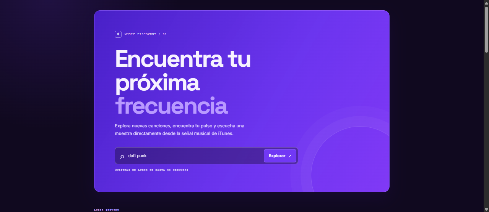
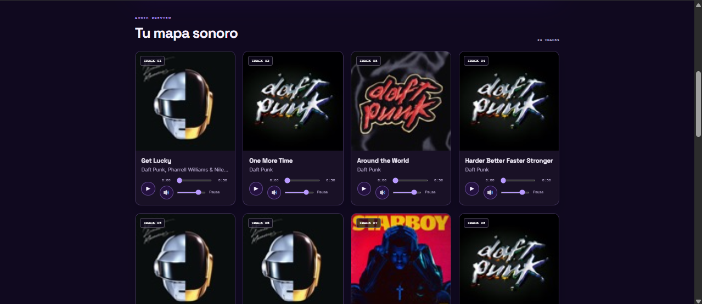

# Frecuencia: buscador de canciones

Aplicación web escolar para buscar canciones mediante la **iTunes Search API** y reproducir una muestra de audio de hasta 30 segundos. Los resultados se muestran como tarjetas con la portada, el título, el artista y un reproductor personalizado.

## Captura o descripción de la interfaz

_La interfaz presenta un encabezado morado con el buscador y una sección de resultados con tarjetas de canciones. El diseño usa fondos oscuros, detalles morados, animaciones sutiles y controles accesibles para la reproducción._

## Funcionalidades

- Búsqueda de canciones por artista, álbum o título.
- Tarjetas con portada, título y artista.
- Reproductor personalizado con reproducción, pausa, progreso, volumen y silenciar.
- Solo una canción puede reproducirse a la vez.
- La reproducción se detiene al llegar al límite de 30 segundos.
- Estados visibles de carga, búsqueda vacía, resultados vacíos y error.
- Diseño responsive para distintos tamaños de pantalla.
- Controles y etiquetas accesibles, incluyendo estados de foco y textos alternativos para las portadas.

## Tecnologías

- HTML.
- CSS.
- JavaScript puro.
- iTunes Search API.
- Fuentes [Space Grotesk](https://fonts.google.com/specimen/Space+Grotesk) e [Inter](https://fonts.google.com/specimen/Inter).

## API utilizada

La aplicación utiliza la **[iTunes Search API](https://affiliate.itunes.apple.com/resources/documentation/itunes-store-web-service-search-api/)** para consultar canciones.

Esta API no requiere una clave de API. Por ese motivo, el proyecto no contiene claves ni necesita un archivo `.env` para configurarse. Aun así, el archivo `.gitignore` ya incluye `.env` y otros archivos de variables de entorno como medida de seguridad.

## Instrucciones de ejecución

### Opción 1: abrir el archivo directamente

1. Abre la carpeta del proyecto.
2. Entra a la carpeta `app`.
3. Haz doble clic en `index.html`.
4. Escribe un artista, álbum o canción y selecciona **Explorar**.

Cuando la página se abre con el protocolo `file://`, `script.js` usa JSONP para consultar la API, porque `fetch` puede estar restringido en ese contexto.

### Opción 2: usar Live Server en VS Code

1. Abre el proyecto en Visual Studio Code.
2. Instala la extensión **Live Server**, si todavía no la tienes.
3. Abre `app/index.html`.
4. Haz clic derecho sobre el archivo y selecciona **Open with Live Server**.
5. Realiza una búsqueda desde la página abierta por el servidor.

Con Live Server, la aplicación se ejecuta mediante HTTP y utiliza `fetch` para consultar la API.

## Manejo de errores

El archivo `app/script.js` contempla estos casos:

- **Búsqueda vacía:** el formulario no se envía y el campo de búsqueda vuelve a recibir el foco.
- **Falta de resultados:** se muestra el mensaje «No encontramos esa frecuencia» y se sugiere probar con otro término.
- **Error de conexión o de la API:** si la petición falla o la respuesta HTTP no es correcta, se muestra «La señal no está disponible». Esto también cubre respuestas de la API relacionadas con problemas del servicio o un límite de peticiones; el código registra el detalle en la consola.
- **Error de reproducción:** si el navegador no puede reproducir la muestra, la tarjeta muestra «Muestra no disponible» y el error se registra en la consola.
- **Carga:** mientras llega la respuesta se muestra «Sintonizando resultados...».

Las canciones que no incluyen una URL de muestra no se agregan a las tarjetas.

## Declaración de uso de IA

### Herramientas utilizadas

- **Claude ([claude.ai](https://claude.ai)):** se utilizó para resolver el error de Git que impedía hacer `push` al repositorio.
- **GitHub Copilot CLI:** se utilizó para generar y corregir el código de la aplicación: estructura inicial, manejo de errores, uso de JSONP para `file://`, reproducción de una sola canción a la vez y rediseño visual.
- **ChatGPT:** se utilizó para redactar el prompt del rediseño visual.

### Trabajo realizado sin ayuda de IA

- Subir los commits al repositorio de GitHub.
- Realizar las pruebas manuales.
- Decidir los nuevos colores y la tipografía.

## Errores y problemas encontrados

- **Push rechazado por Git:** el repositorio local estaba detrás de la rama remota. Se resolvió integrando los cambios remotos con `git pull origin main --rebase --allow-unrelated-histories` y después realizando el `push`.
- **Pantalla vacía al buscar:** al principio no se mostraban explicaciones cuando fallaba la petición. Se resolvió agregando validación, estados de carga y vacío, comprobación de `response.ok` y un bloque `try...catch`.
- **Restricción de `fetch` con `file://`:** abrir `index.html` directamente podía impedir la petición. Se resolvió usando JSONP cuando el protocolo es `file://` y manteniendo `fetch` cuando la aplicación se ejecuta mediante un servidor.
- **Reproducción simultánea:** varias canciones podían reproducirse al mismo tiempo. Se resolvió pausando la muestra activa antes de iniciar otra.

JSONP permite ejecutar la respuesta de un script externo y, por esa razón, es una solución menos segura que `fetch`. Se utiliza aquí únicamente para permitir la ejecución directa del archivo en el navegador.

## Bitácora

Consulta el detalle del proceso en [`bitacora.md`](bitacora.md).

## Autor

**Iván Alí Rodriguez Arceo**

Aplicaciones Web

24 de octubre del 2026